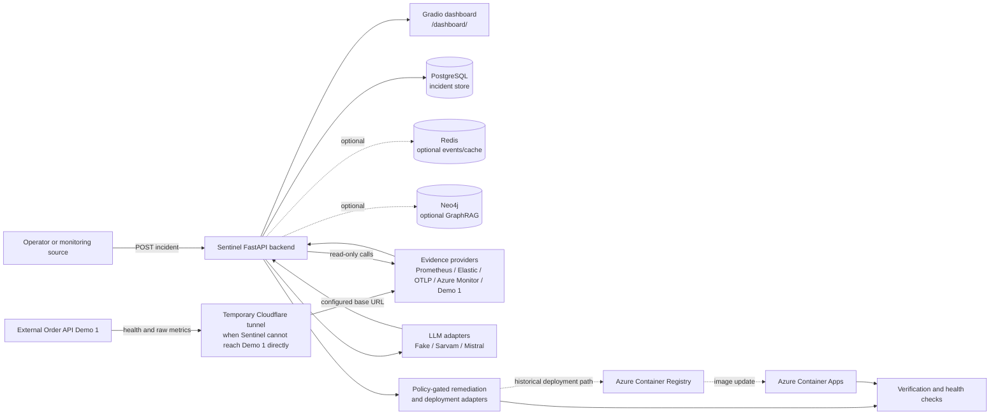

# Sentinel AI

Sentinel AI is an AI-assisted SRE/AIOps platform for turning operational signals into a reviewable incident-response workflow. It accepts an incident, persists it in PostgreSQL, gathers evidence, produces hypotheses and a probable root-cause analysis (RCA), proposes policy-controlled remediation, and contains validation/deployment integration points for verifying recovery.

This repository is both an implementation and a demonstration scaffold. Some integrations are real adapters, some are test doubles or optional providers, and the dashboard deliberately contains an initial mock snapshot. The distinction matters: a passing unit test or a pre-populated dashboard is not evidence of a live production incident being detected or remediated.

## Table of contents

- [Project overview](#project-overview)
- [Architecture](#architecture)
- [Features](#features)
- [Demo 1 — Autonomous SRE test](#demo-1--autonomous-sre-test)
- [Demo 2 — AI SRE remediation PR](#demo-2--ai-sre-remediation-pr)
- [Dashboard](#dashboard)
- [Technology stack](#technology-stack)
- [Local setup](#local-setup)
- [API reference](#api-reference)
- [Testing and validation](#testing-and-validation)
- [Azure deployment and cleanup](#azure-deployment-and-cleanup)
- [Limitations and future work](#limitations-and-future-work)
- [Project structure](#project-structure)
- [Demo evidence](#demo-evidence)
- [License and contribution](#license-and-contribution)

## Project overview

Operational teams often have to correlate a failing service, database symptoms, telemetry, and a possible fix across several tools. Sentinel provides a single incident-oriented control plane for that workflow:

1. Detect or receive an operational issue.
2. Collect available health, metric, log, trace, deployment, and knowledge evidence.
3. Analyze the evidence and rank probable causes.
4. Produce an RCA and a remediation plan.
5. Execute only actions allowed by the configured remediation policy and integrations.
6. Validate health and metric outcomes and resolve or escalate the incident.

The main HTTP application is a FastAPI service. `POST /api/v1/incidents` persists an incident and invokes the closed-loop orchestrator inline for a new incident. The repository also contains asynchronous/event-oriented abstractions, provider interfaces, policy gates, deployment adapters, and verification models for extending that flow.

## Architecture

The implemented runtime is centered on the Sentinel backend:

- **Sentinel backend** — FastAPI application assembled in `backend/application/factory.py`. It exposes health, Prometheus-format metrics, incident ingestion, incident reads, and the mounted Gradio dashboard.
- **Dashboard** — A read-only Gradio application mounted at `/dashboard/`. It can call Sentinel health/incidents and, when configured, the Demo 1 read-only endpoints.
- **Order API Demo 1** — An external service, not included in this repository. Sentinel's `Demo1EvidenceProvider` reads `GET /health` and `GET /metrics/raw` from its configured `SENTINEL_DEMO1__BASE_URL` for incidents that match the strict Demo 1 predicate: `environment=demo`, a `demo1` tag, and a `correlation_id` beginning with `demo1-`.
- **PostgreSQL** — Stores incidents through SQLAlchemy/asyncpg and Alembic migrations. The local Compose file also starts Redis and optional Neo4j because the application composition root can use them for event and retrieval capabilities.
- **Observability and metrics** — Prometheus client output is exposed at `/metrics`; OpenTelemetry instrumentation can export traces/metrics through OTLP or Azure Monitor. Optional evidence providers support Prometheus, Elastic, OTLP, and Azure Monitor snapshots. Demo 1 metrics are read from the external Order API's `/metrics/raw` endpoint.
- **LLM integration** — The provider-neutral LLM interface supports a fake provider for tests plus Sarvam and Mistral HTTP adapters, with optional fallback. The LLM investigation agent uses evidence to produce structured investigation/RCA output; provider credentials and live calls are optional.
- **Azure deployment** — The historical deployment path builds a container image in Azure Container Registry (ACR) and updates an Azure Container App. The checked-in GitHub Actions workflow does not provision infrastructure.



The tunnel is a temporary network bridge used during a demonstration; it is not implemented or configured by this repository. No Cloudflare hostname, tunnel token, or tunnel command is committed. Likewise, the diagram's optional providers and Azure integrations are code paths/configuration options, not proof that every provider was enabled in the demonstration.

## Features

Verified from the source and tests:

- Liveness and process health at `GET /health` and `GET /health/live`.
- Dependency-aware readiness at `GET /health/ready`, returning `503` when configured checks are not ready.
- Prometheus-compatible process/application metrics at `GET /metrics`.
- Authenticated incident ingestion using `X-Sentinel-Incident-Key`; correlation IDs de-duplicate already-open incidents.
- PostgreSQL-backed incident retrieval and paginated listing with status/severity filters.
- Incident lifecycle models for evidence collection, hypothesis evaluation, RCA, remediation plans, validation, deployment status, resolution, and escalation.
- Evidence adapters and normalization for configured metrics/logs/traces sources, Azure Monitor snapshots, and the read-only Demo 1 Order API adapter.
- Policy-gated remediation engines, fake/test executors, rollback models, deployment provider interfaces, and verification coordination.
- LLM abstraction with fake, Sarvam, and Mistral providers and optional fallback. The default provider is the fake provider unless an LLM provider is configured.
- Read-only Gradio dashboard with live refresh calls bounded by HTTP and overall refresh timeouts.

The dashboard's initial values are explicitly mock/demo values. The repository tests also use fakes and mocked HTTP transports for most integration paths. These are useful for validation, but they are not live telemetry, a live LLM response, or proof that a real remediation changed infrastructure.

## Demo 1 — Autonomous SRE test

Demo 1 exercises the SRE workflow against an Order API backed by PostgreSQL in Azure. We intentionally introduced a database connection-pool exhaustion bug in the Order API. The resulting Azure database failure degraded the service and produced the logs/incident signal that was sent to Sentinel for investigation.

Sentinel then used the configured Demo 1 integration to read the Order API health and raw pool metrics, correlate the failure with the incident, identify the probable connection-pool root cause, and present remediation and recovery checks. The test uses `SENTINEL_DEMO1__BASE_URL` and the incident markers required by the Demo 1 evidence adapter.

### Test sequence

1. Start with the Azure-hosted Order API and its PostgreSQL dependency healthy. Confirm the Order API's `GET /health` response and make its base URL available to Sentinel as `SENTINEL_DEMO1__BASE_URL`. During the demonstration, a temporary Cloudflare tunnel provided the reachable URL where required.
2. Intentionally introduce the database connection-pool exhaustion bug in the Order API. The real Azure PostgreSQL dependency then fails under the faulty workload, causing degraded health, errors, increased latency, and exhausted-pool metrics.
3. Observe the Order API's degraded health, errors, latency, and pool data through its supported endpoints, especially `GET /health` and `GET /metrics/raw`.
4. Send the resulting logs/incident signal to the deployed Sentinel API. The incident must carry the Demo 1 markers if the Demo 1 evidence provider is to participate: `environment: "demo"`, a `demo1` tag, and a `correlation_id` starting with `demo1-`.
5. Inspect the persisted incident with `GET /api/v1/incidents/{incident_id}` or list it with `GET /api/v1/incidents`. The closed-loop service may collect Demo 1 health and pool evidence and run its configured investigation path.
6. Present the RCA and remediation recommendation from the orchestrator's internal result/events or persisted metadata when those are enabled and exposed by the configured repository. The current incident read schema does not provide a separate RCA endpoint.
7. Apply the appropriate fix through the configured, policy-approved remediation integration. Verify recovery with health and metric checks before closing the incident.

Example incident submission (replace the placeholder with a secret held in the environment):

```bash
curl -X POST "http://127.0.0.1:8000/api/v1/incidents" \
  -H "Content-Type: application/json" \
  -H "X-Sentinel-Incident-Key: $SENTINEL_INCIDENT_API_KEY" \
  -d '{
    "title": "Order API database connection pool exhausted",
    "description": "The Order API reports no free database connections.",
    "severity": "high",
    "affected_services": ["order-api"],
    "environment": "demo",
    "correlation_id": "demo1-order-api-connection_leak-pool-exhausted",
    "symptoms": ["Database connection pool exhausted"],
    "tags": ["demo1", "database"]
  }'
```

Read-only checks used by the adapter/dashboard are:

```bash
curl "${SENTINEL_DEMO1__BASE_URL}/health"
curl "${SENTINEL_DEMO1__BASE_URL}/metrics/raw"
curl "http://127.0.0.1:8000/api/v1/incidents?limit=50"
curl "http://127.0.0.1:8000/api/v1/incidents/{incident_id}"
```

The response fields of the external Order API are not defined in this repository. The adapter accepts `service`, `version`, `failure_mode`, `db_pool`/`pool`, `metrics`, and `status` when present and treats unavailable calls as missing evidence rather than fabricating healthy observations.

## Demo 2 — AI SRE remediation PR

Demo 2 is the planned code-remediation workflow for Sentinel. Its goal is to demonstrate that Sentinel can go beyond explaining an incident by generating a code fix and opening a GitHub Pull Request for review.

### How Demo 2 works

1. **Trigger an incident.** A service has a code-level bug causing high latency or errors.
2. **Investigate with Sentinel.** The LLM analyzes the incident and identifies a likely root cause and code-level fix.
3. **Generate a remediation PR.** Sentinel proposes a patch, creates a GitHub branch, and opens a pull request.
4. **Validate the fix.** Run tests and inspect the proposed changes. Merging remains a manual decision.

### Example scenario

The planned example is an async FastAPI endpoint that performs a synchronous, blocking operation inside an `async` request handler. Under concurrent requests, the event loop is blocked, latency rises, and requests may time out. Sentinel's task is to investigate the incident, identify the blocking call, propose a minimal fix, and open a PR containing the code change and a regression test.

### Connection to Sentinel

The demonstration incident was intended to be sent to the deployed Sentinel API:

```text
https://sentinel-api.yellowcoast-fc0c600b.centralindia.azurecontainerapps.io/api/v1/incidents
```

If the existing GitHub remediation workflow is correctly configured, Sentinel can use its planner and GitHub provider to create the PR. The exact incident payload and code-context mechanism still need to be verified against the current implementation. The PR workflow is target behavior, not a confirmed end-to-end capability in this repository; the next validation step is to inspect the existing planner, GitHub executor, configuration, and incident schema before building another service.

## Dashboard

The dashboard is available at `/dashboard/` on the same host and port as Sentinel. It contains:

- a service-health panel;
- a table of persisted/historical incidents;
- RCA and remediation-plan panels;
- a raw Order API metrics panel.

The first dashboard render was changed to use synchronously constructed, pre-populated `DEMO DATA` because the live Gradio refresh callback was hanging during initial load. The initial health, incident, RCA, plan, and metric values are mock values and are not live telemetry. They do not prove live incident detection, live RCA, or autonomous remediation.

The **Refresh dashboard** button is the live path. It calls Sentinel `/health` and `/api/v1/incidents?limit=50`, and, when `SENTINEL_DEMO1__BASE_URL` is configured, the Order API `/health` and `/metrics/raw`. Each request has a five-second HTTP timeout and the whole refresh has a ten-second bound. Failures are rendered as `UNAVAILABLE`; the dashboard remains read-only and does not execute, approve, deploy, or trigger remediation.

## Technology stack

- **Language/runtime:** Python 3.12.
- **Web/API:** FastAPI, Uvicorn, Pydantic, Pydantic Settings, Dishka dependency injection, Gradio.
- **Persistence:** PostgreSQL, SQLAlchemy asyncio, asyncpg, Alembic.
- **Supporting stores:** Redis; optional Neo4j, Azure Cosmos DB, and Azure Blob Storage adapters.
- **Observability:** Prometheus client, OpenTelemetry SDK/exporters/instrumentation, Azure Monitor/Application Insights exporter, Structlog.
- **AI/LLM:** provider-neutral LLM contracts; fake provider for tests; Sarvam and Mistral OpenAI-compatible HTTP adapters; optional fallback.
- **Integration/deployment:** HTTPX/aiohttp, Azure Identity/Key Vault/Monitor SDKs, GitHub API deployment providers, Docker, Azure Container Registry, Azure Container Apps, GitHub Actions.
- **Development quality:** uv, pytest, pytest-asyncio, Ruff, mypy.

## Local setup

### Prerequisites

- Python 3.12.
- [uv](https://docs.astral.sh/uv/).
- Docker and Docker Compose if using the full local dependency stack.
- Optional external services/credentials for live LLM, observability, Azure, GitHub, or Demo 1 integration.

Install dependencies and create a local environment file:

```bash
cp .env.example .env
uv sync
```

Set the values required for the services you enable. Important variables include:

- `SENTINEL_INCIDENT_API_KEY` for `POST /api/v1/incidents`;
- `SENTINEL_POSTGRES__*` and `SENTINEL_REDIS__*` (or URL variants);
- `SENTINEL_DEMO1__BASE_URL` for the optional external Order API;
- `SENTINEL_LLM__PRIMARY__NAME` and `SENTINEL_LLM__PRIMARY__API_KEY` for a live LLM provider;
- `SENTINEL_OPENTELEMETRY__*`, `SENTINEL_EVIDENCE__*`, and optional Azure/GitHub settings for external integrations.

Do not commit `.env`, API keys, passwords, connection strings, tokens, or client secrets. Keep secrets in environment variables, Docker secrets, Azure Key Vault, or another approved secure secret store.

### Start the local stack

The Compose file starts Sentinel, a migration job, PostgreSQL, Redis, and Neo4j:

```bash
docker compose up --build
```

The API is then available at `http://127.0.0.1:8000`. The Compose application environment uses local development credentials defined in the Compose file; do not reuse them for shared or production environments.

To run the application directly instead, provide a reachable PostgreSQL database and run migrations before starting Uvicorn:

```bash
uv run alembic upgrade head
uv run uvicorn main:app --host 0.0.0.0 --port 8000 --reload
```

The external Order API Demo 1 must be started separately. This repository only provides the client-side evidence adapter and dashboard calls; it does not provide a Demo 1 server process or its failure simulator.

### Health and tests

```bash
curl http://127.0.0.1:8000/health
curl http://127.0.0.1:8000/health/live
curl -i http://127.0.0.1:8000/health/ready
curl http://127.0.0.1:8000/metrics
uv run pytest -q
```

## API reference

The following routes are implemented in `backend/api/routers`:

| Method | Path | Purpose | Authentication/notes |
| --- | --- | --- | --- |
| `GET` | `/health` | Process/service health. | No incident key. |
| `GET` | `/health/live` | Liveness probe. | No incident key. |
| `GET` | `/health/ready` | Concurrent configured dependency readiness. | Returns `503` when not ready. |
| `GET` | `/metrics` | Prometheus-compatible metrics exposition. | Open endpoint in the application. |
| `POST` | `/api/v1/incidents` | Validate, persist, de-duplicate, and start the closed-loop path for a new incident. | Requires `X-Sentinel-Incident-Key` configured and supplied. |
| `GET` | `/api/v1/incidents` | Paginated incident list. | Supports `status`, `severity`, `limit`, and `offset` query parameters. |
| `GET` | `/api/v1/incidents/{incident_id}` | Retrieve one persisted incident. | Returns `404` when absent. |
| `GET` | `/dashboard/` | Mounted read-only Gradio dashboard. | Same application host; not a JSON API. |

`POST /api/v1/incidents` accepts `title`, `description`, `severity` (`critical`, `high`, `medium`, or `low`), at least one `affected_services` item, and optional environment, tenant, correlation ID, symptoms, tags, signals, detection time, and metadata. A matching open `correlation_id` is treated as a duplicate. The response includes the incident, `is_duplicate`, and an existing incident ID when applicable.

There is no dedicated implemented `/rca`, `/remediation`, or `/recover` route in this repository. RCA, remediation, deployment, and verification are internal service/domain lifecycle outputs and optional integration paths; the dashboard can display RCA/plan data only when it is present in returned incident metadata, otherwise it labels the content as demo/mock or unavailable.

## Testing and validation

Tests live under `backend/tests` and cover, among other areas, configuration, health, database and repositories, API routes, dashboard rendering/refresh behavior, Demo 1 evidence collection, LLM abstractions/providers/investigation, evidence providers, policy gates, remediation and rollback, closed-loop orchestration, verification, telemetry, retrieval, and deployment adapters.

The repository's configured validation commands are:

```bash
uv run pytest -q
uv run ruff check .
uv run mypy .
```

`live_llm` is an opt-in pytest marker for a configured real LLM provider; ordinary tests use fakes or mocks and do not prove a live provider call. Run focused checks when external dependencies are unavailable, for example:

```bash
uv run pytest -q backend/tests/test_dashboard.py backend/tests/test_demo1_integration.py backend/tests/test_incident_api.py
```

Document a command's actual result in demonstration evidence. Do not describe the entire suite as passing unless that exact command has been run successfully in the current environment.

## Azure deployment and cleanup

The previous demo deployment used a container image built from `Dockerfile`, pushed to Azure Container Registry, and deployed to Azure Container Apps. The broader application has optional Azure Database for PostgreSQL, Azure Monitor/Application Insights, Key Vault, Blob Storage, Cosmos DB, and managed-identity integrations; those are configured in application code and are not provisioned by the workflow.

`.github/workflows/deploy-azure.yml` retains these steps:

1. Checkout the repository.
2. Install Python 3.12, uv, and locked dependencies.
3. Run pytest, Ruff, and mypy.
4. Log in to Azure with GitHub OIDC variables.
5. Build and push the image with `az acr build`.
6. Update the named Azure Container App.
7. Query the deployed image and poll `https://<container-app-fqdn>/health` for verification.
8. Write build/deployment outcomes to the GitHub Actions summary.

Automatic deployment on pushes to `main` is disabled because the demo Azure resources were deleted. `workflow_dispatch` remains, but a manual run will require the infrastructure, registry, Container App, Azure permissions, GitHub OIDC variables, and application secrets to be recreated first. The workflow does not create those resources. Follow [`docs/09_DEPLOYMENT.md`](docs/09_DEPLOYMENT.md) for the deployment model and prerequisites rather than assuming the historical resource names are still available.

The hosted demo dashboard is therefore not guaranteed to be available. No deployment, resource recreation, cleanup, commit, or push is performed by this repository update.

## Limitations and future work

### Verified capabilities

- The FastAPI health, metrics, incident, and dashboard routes are implemented and covered by focused tests.
- The Demo 1 adapter makes bounded read-only calls to configured `/health` and `/metrics/raw` endpoints and is strict about which incidents it handles.
- The closed-loop domain code has policy, fake-provider, remediation, deployment, and verification tests.
- LLM adapters and investigation prompting are implemented; fake-provider tests verify the abstraction and investigation behavior.

### Current limitations

- The external Order API Demo 1 and its database-pool failure mechanism are not included, so a live failure injection and live recovery cannot be reproduced from this repository alone.
- The temporary Cloudflare tunnel is operational setup, not committed application configuration.
- The dashboard starts with synchronous mock values because the original live Gradio refresh callback hung. Those values are not live telemetry.
- The refresh button is read-only and can show live endpoint responses only when the configured services are reachable; it does not execute remediation.
- The API does not expose dedicated RCA or remediation read/action routes.
- Live LLM execution depends on provider credentials and configuration. The ordinary test suite does not establish that a real provider was successfully called in a demonstration.
- Remediation plans are recommendations unless an explicitly enabled, policy-approved executor is configured. Tests with fake executors do not prove an Azure restart, GitHub deployment, or other real side effect.
- Azure resources used for the demo have been deleted; deployment and hosted availability require infrastructure recreation.

Future work should include a reproducible Demo 1 fixture/failure harness, durable and authenticated RCA/remediation views, a non-hanging live dashboard refresh path, saved end-to-end evidence, explicit approval UX for higher-risk actions, and a recreated sandbox deployment with verified telemetry and recovery.

## Project structure

```text
.
├── backend/
│   ├── api/                 # FastAPI routes and schemas
│   ├── application/         # Composition root and dependencies
│   ├── configuration/       # Typed environment settings
│   ├── core/                # Evidence, RCA, remediation, validation engines
│   ├── dashboard.py         # Read-only Gradio dashboard
│   ├── db/                  # SQLAlchemy models, sessions, migrations, repositories
│   ├── infrastructure/      # Redis, Neo4j, Cosmos, Azure helpers
│   ├── providers/            # Evidence, LLM, metrics, and GitHub adapters
│   ├── services/             # Incident, investigation, orchestration, verification
│   ├── telemetry/            # OpenTelemetry and metrics setup
│   ├── tests/                # Unit and integration-style tests
│   └── workflows/            # Runtime and SRE workflow models
├── docs/                    # Architecture, API, observability, deployment, testing
├── .github/workflows/       # Manual Azure deployment workflow
├── Dockerfile               # Container image definition
├── docker-compose.yml       # Local API and dependency stack
├── main.py                  # ASGI entry point
├── pyproject.toml           # Dependencies and tool configuration
├── .env.example             # Configuration template without secrets
└── uv.lock                 # Locked Python dependencies
```

## Demo evidence

A complete project demonstration should preserve dated, redacted artifacts for:

- healthy Order API and Sentinel health responses;
- the degraded PostgreSQL/connection-pool state, including the external Demo 1 mechanism used;
- observed errors, latency, and pool metrics;
- the incident submission and persisted incident record;
- evidence collection and incident-detection output;
- RCA/probable-cause output and its evidence references;
- remediation recommendation and policy decision;
- any separately approved remediation action;
- post-action health/metric recovery and incident resolution;
- the dashboard initial mock snapshot and a refreshed live view;
- Azure ACR/Container Apps deployment and health-verification output, if infrastructure is recreated;
- exact passing pytest, Ruff, and mypy commands and their outputs.

No such screenshots or external deployment artifacts are claimed to be saved in this repository. The checked-in tests and source files are implementation evidence, not a substitute for live demo evidence.

## License and contribution

The root `LICENSE` file is currently empty, and `CONTRIBUTING.md` is currently empty. No license terms or contribution process are asserted here beyond the repository's existing files. Add the project's approved license and contribution guidance before publishing or accepting external contributions.
